# Tutin Landing Page (Tutin-LandingPage) 🎓🌐

[](https://developer.mozilla.org/en-US/docs/Web/Guide/HTML/HTML5)
[](https://developer.mozilla.org/en-US/docs/Web/CSS)
[](https://developer.mozilla.org/en-US/docs/Web/JavaScript)
[](LICENSE)
[](https://github.com/dhruvgoel3/Tutin-LandingPage)

> The clean, aesthetic, and responsive official landing page for **Tutin** — India's Digital Tuition Identity & Batch Management Platform.

---

## 🌟 Overview

This repository contains the complete, standalone landing page for **Tutin**, meticulously built to mirror the branding, design tokens, and educational workflows of the native Flutter mobile application.

It features:
- **Hero Device Mockup**: Seamlessly showcasing native app screens with an interactive Teacher / Student View toggle.
- **Bento Grid Features**: High-impact visual cards highlighting Smart Batches, Fee Tracking, Visiting Cards, and Local Discovery.
- **Interactive Tour Sandbox**: Mac-style window previewing live batch rosters, receipt downloads, and announcement feeds.
- **Hyperlocal Tutor Search Bar**: Dynamic capsule search filter by Subject, Board, Class, and City.
- **Fintech Fee & ROI Calculator**: Real-time slider calculations for monthly tuition volume, recovered unpaid dues, and hours saved.
- **Verified Reviews & FAQ Accordion**: Authentic student testimonials with filter pills and smooth collapsible questions.

---

## 📱 Mobile App Screens Gallery

The landing page directly showcases Tutin's 21 native Flutter application screens. Below is the complete gallery of production screenshots included in this repository under `/screenshots`.

### 1. Onboarding & Welcome Sequence
| Batch Management | Fee Tracking | Local Discovery | Role Selection | Create Account |
|:---:|:---:|:---:|:---:|:---:|
| 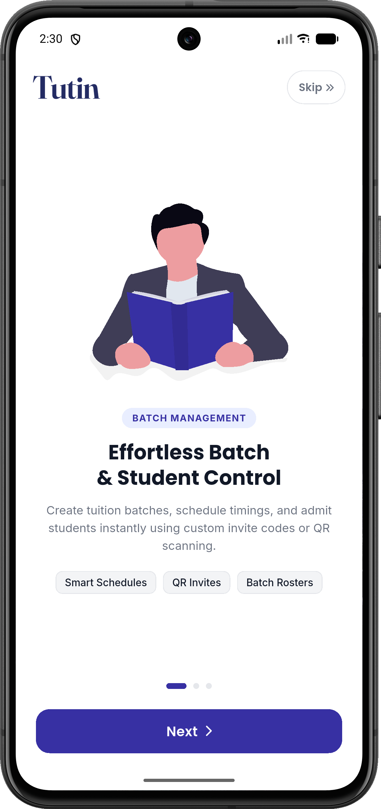 | 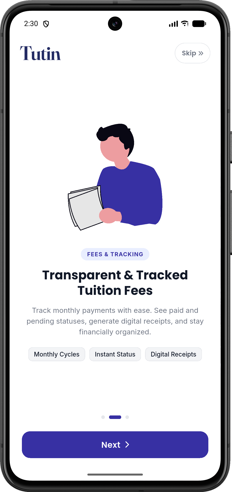 | 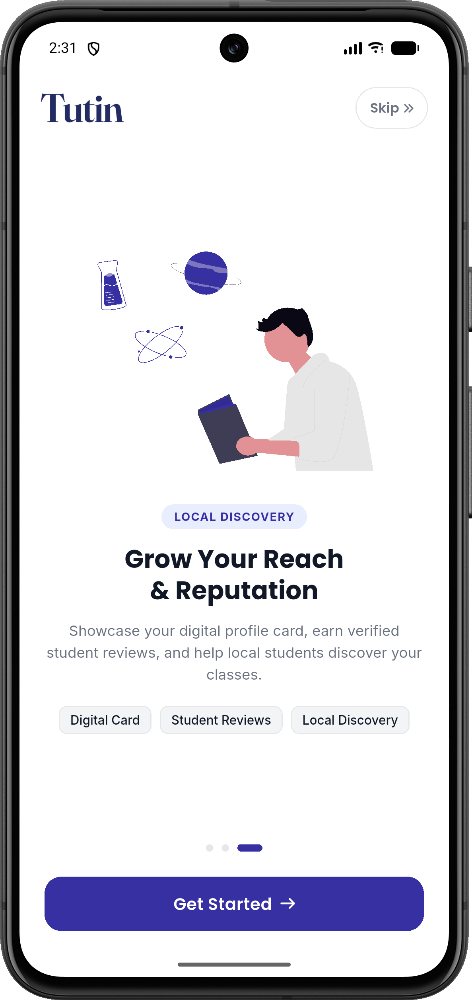 | 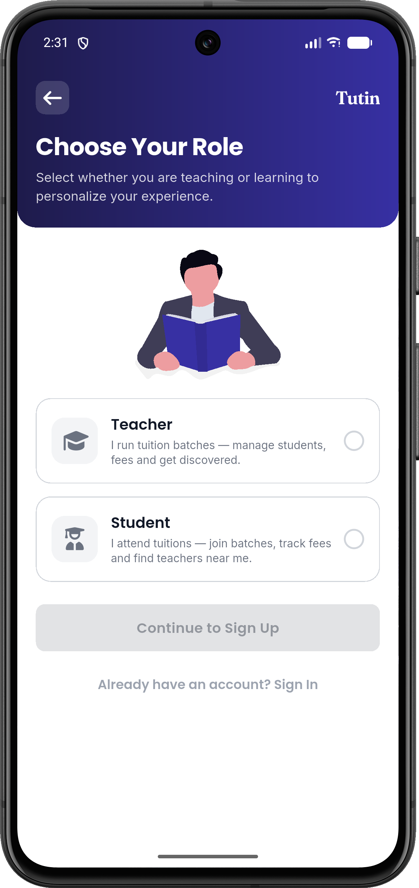 | 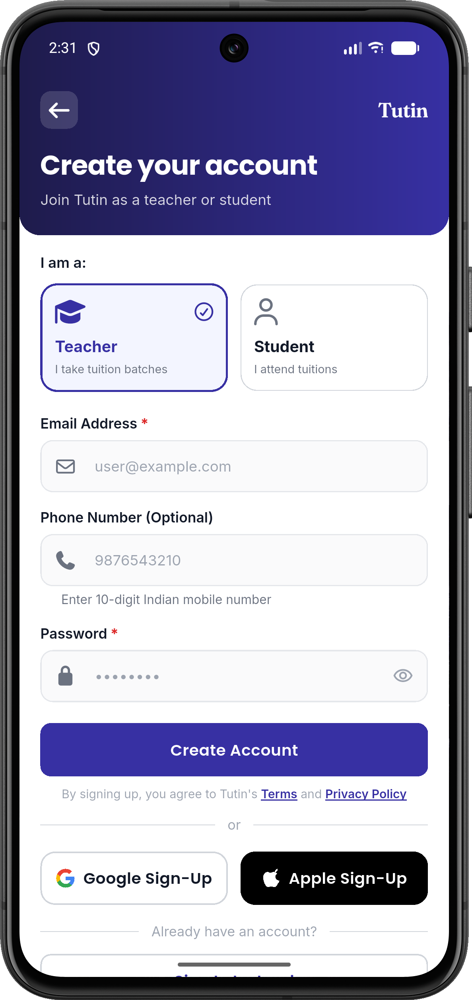 |
| *Roster control & timetable scheduling* | *Automated monthly fee cycles & receipts* | *Grow local presence in your neighborhood* | *Teacher vs. Student role selection* | *Fast mobile signup & authentication* |

---

### 2. Teacher Onboarding & Geolocation Setup
| Teacher Identity Setup | Tuition Center Map Pin | Classes & Subjects |
|:---:|:---:|:---:|
| 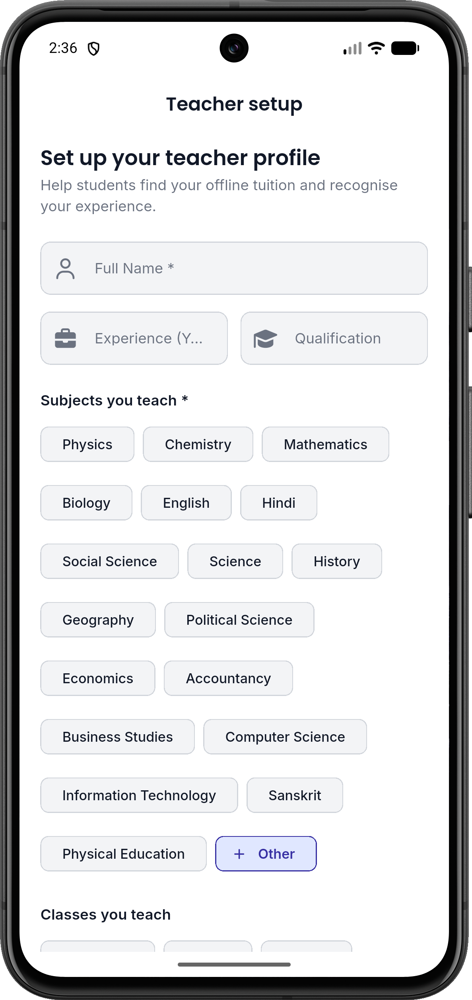 | 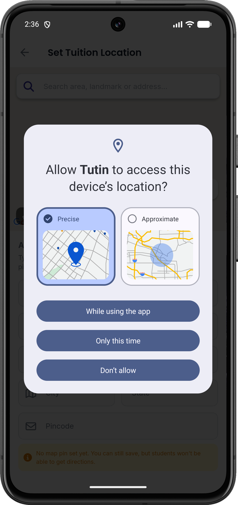 | 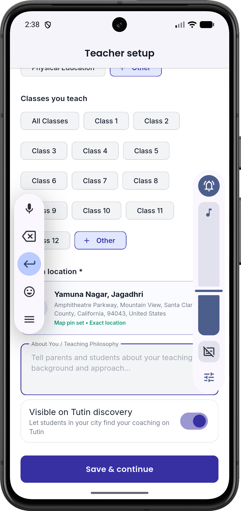 |
| *Set up your public tuition identity* | *Interactive Google Maps address & landmark picker* | *Declare boards, grade levels, and subjects taught* |

---

### 3. Teacher Command Dashboard & Profile
| Teacher Command Center | Digital Visiting Card | Teacher Profile & Settings |
|:---:|:---:|:---:|
| 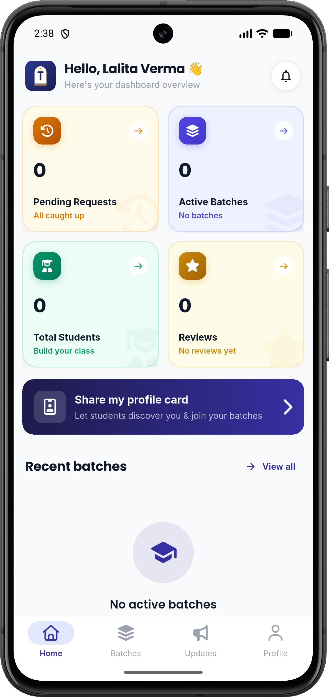 | 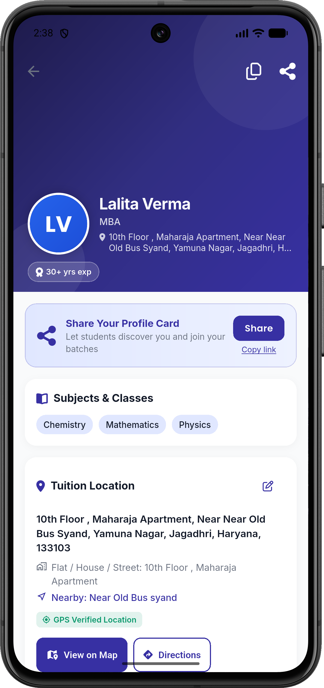 |  |
| *Active batches, join requests, and fee totals* | *Shareable web profile card (`tutin.app/teacher/id`)* | *Update qualifications, bio, and social channels* |

---

### 4. Batch Operations & Study Materials Hub
| Create New Batch | Batch Roster Manager | Batch Updates Noticeboard | Publish Announcement Modal |
|:---:|:---:|:---:|:---:|
| 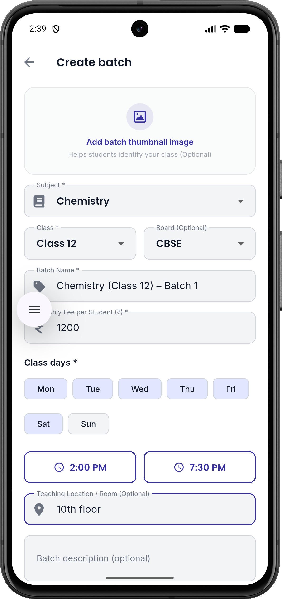 | 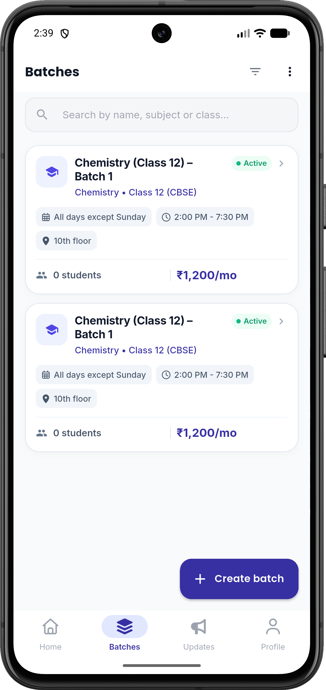 | 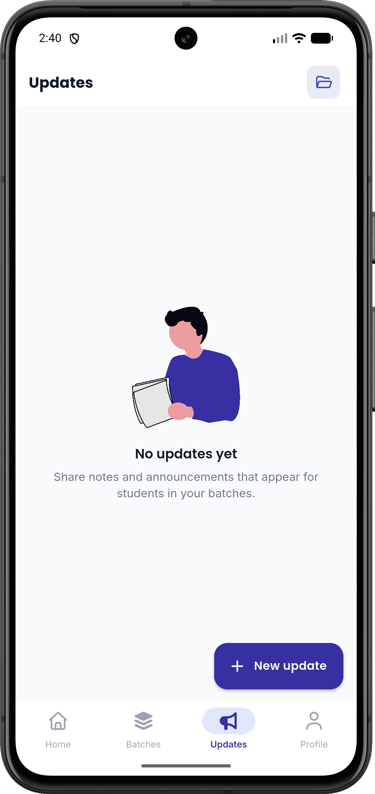 | 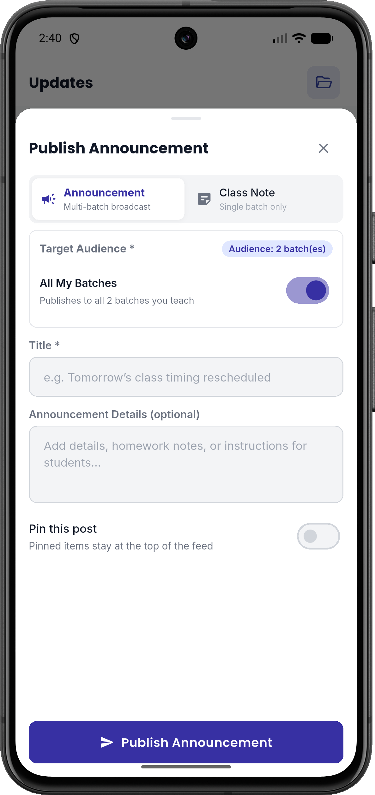 |
| *Set custom days, hours, & limits* | *Student enrollment & join approvals* | *Central noticeboard replacing WhatsApp* | *Distribute revision notes & homework PDFs* |

---

### 5. Student Discovery & QR Admissions
| Student Profile Setup | Student Home Feed | Hyperlocal Teacher Search | Scan Batch QR Code | Enrolled Batches | Student Profile |
|:---:|:---:|:---:|:---:|:---:|:---:|
| 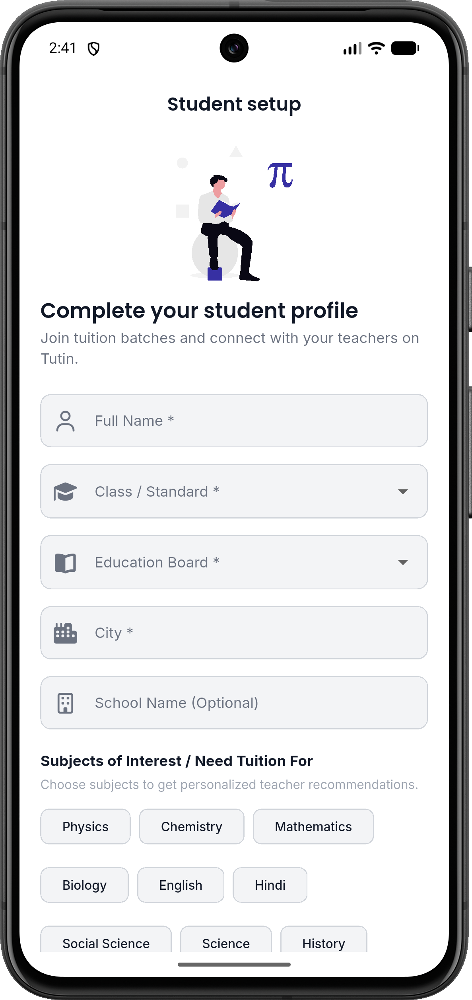 | 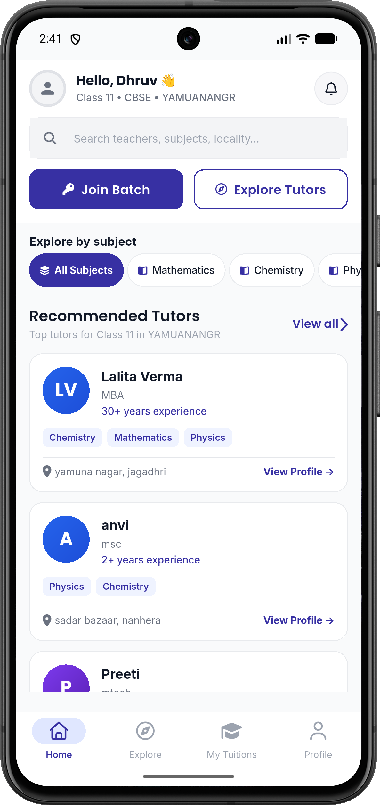 | 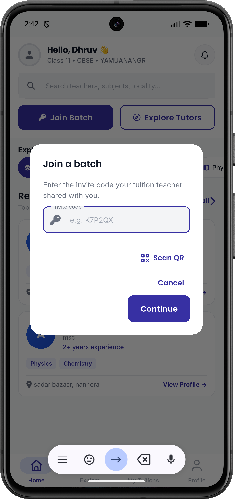 | 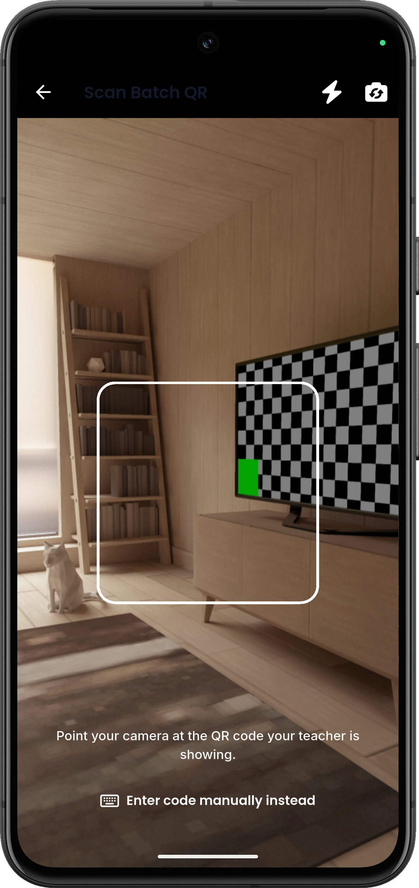 | 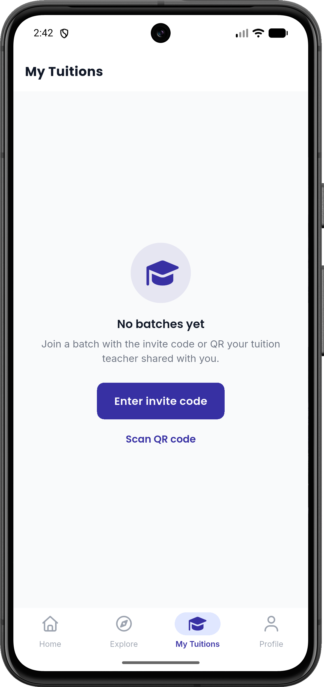 | 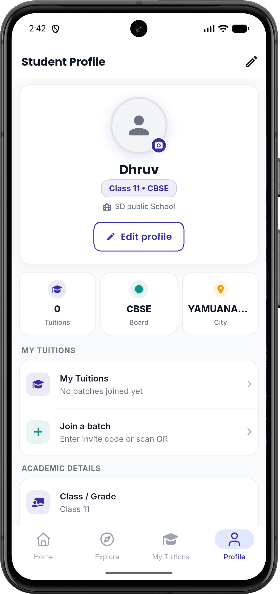 |
| *Board & grade selection* | *Enrolled classes & reminders* | *Filter nearby tutors* | *1-Second camera QR join* | *Timetables & fee status* | *Academic profile & passbook* |

---

## 🎨 Design System & Visual Tokens

The landing page implements the brand tokens defined in the Tutin Flutter app (`AppColors`):

| Token | Value | Role |
|:---|:---|:---|
| `--primary` | `#3730A3` | Deep Indigo brand primary |
| `--primary-light` | `#6366F1` | Vibrant indigo interactive state |
| `--primary-dark` | `#1E1B4B` | Dark surface & contrast headers |
| `--primary-container`| `#EEF2FF` | Soft indigo card tint |
| `--secondary` | `#0D9488` | Teal secondary brand color |
| `--secondary-light` | `#2DD4BF` | Teal interactive accent |
| `--secondary-container`| `#CCFBF1` | Soft teal chip background |
| `--success` | `#059669` | Paid status & verified badges |
| `--accent` | `#F59E0B` | Gold star ratings & announcements |
| `--font-heading` | `'Poppins', sans-serif` | Modern bold heading typography |
| `--font-body` | `'Inter', sans-serif` | Clean, legible body copy |

---

## 📁 Repository Structure

```text
Tutin-Landing/
├── index.html                   # Semantic HTML5 document
├── styles.css                   # Custom Vanilla CSS3 design system
├── script.js                    # Interactive DOM controller & event handlers
├── assets/
│   ├── avatars/                 # Verified student & teacher avatars
│   ├── fonts/                   # Local Poppins & Inter web fonts
│   ├── icons/                   # App icons & favicon
│   ├── illustrations/           # Modern SVG vector illustrations
│   ├── images/                  # Tutin brand logos & badges
│   └── screenshots/             # 21 high-resolution native app screenshots
├── screenshots/                 # GitHub README screenshot directory
└── README.md                    # Project documentation
```

---

## 🚀 Running Locally

No bundlers or build steps required. Simply serve using any standard static file server:

```bash
# Python 3
python3 -m http.server 4321

# Node.js (npx)
npx serve .
```

Open `http://localhost:4321` in your browser.

---

## 📄 License

Distributed under the MIT License. Developed for India's independent tuition teachers, students, and parents.

&copy; 2026 **Tutin Product**. All rights reserved.
